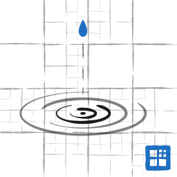

<div align="center">

<picture>
  <source media="(prefers-color-scheme: dark)"  srcset="docs/public/logo-dark.svg">
  <source media="(prefers-color-scheme: light)" srcset="docs/public/logo.svg">
  
</picture>

#### *time integrators as stage-wise operators, the pause between stages left to your solver, on every CPU and GPU*

### **S**tage-wise **E**volution **L**ibrary for **A**ccelerators and **H**PC

> Time-evolution operators for block-structured field solvers, in modern Fortran. Successor of FOODIE: verified scheme
> tableaux, bandwidth-bound kernels over the caller's arrays, and a stepper the caller drives one stage at a time, with
> no dynamic dispatch where the cells are swept.

[](https://github.com/szaghi/SELAH/releases)
[](https://github.com/szaghi/SELAH/actions/workflows/ci.yml)
[](https://github.com/szaghi/SELAH/actions/workflows/matrix.yml)
[](https://fortran-lang.org/)
[](LICENSE.gpl3.md)
[](LICENSE.bsd-2.md)
[](LICENSE.bsd-3.md)
[](LICENSE.mit.md)

<div>
<table>
<tr>
<td><b>🧮 A verified catalogue</b><br><sub>Eight Runge–Kutta schemes (euler, SSP(2,2), SSP(3,3), SSP(5,4), SSP(10,4), rk4, and the low-storage LSRK(3,3) and LSRK(5,4)) and four splittings (Strang, Yoshida, Blanes–Moan S6 and S10). Order conditions in quadruple precision, SSP coefficients computed, never typed in. <a href="https://szaghi.github.io/SELAH/guide/schemes">Schemes</a> · <a href="https://szaghi.github.io/SELAH/api/">API</a></sub></td>
<td><b>⚡ Kernels over your arrays</b><br><sub>Stage and update operations on block-structured fields with ghost cells, in two layouts, masked or not: they write the cells of the box and nothing else. One source for the host, OpenMP and OpenACC. <a href="https://szaghi.github.io/SELAH/guide/kernels">Kernels</a> · <a href="https://szaghi.github.io/SELAH/guide/performance">Performance</a></sub></td>
</tr>
<tr>
<td><b>🎛️ A stepper you drive</b><br><sub><code>begin_stage</code>, <code>end_stage</code>, <code>finish_step</code> around your own ghost fill and residual, on fields of rank 1 to 5, under a stage contract an AMR orchestrator can rely on; <code>stage_weight</code> for flux registers, the step residual fused in the update; companion states stepped with the field (particles, PML auxiliary fields, a stiff decay integrated exactly), the per-stage forward-Euler step a limiter needs, additive splitting with your own flow. <a href="https://szaghi.github.io/SELAH/guide/stepper">Stepper</a> · <a href="https://szaghi.github.io/SELAH/guide/composition">Composition</a> · <a href="https://szaghi.github.io/SELAH/guide/particles">Particles</a></sub></td>
<td><b>💾 Low storage, same answer</b><br><sub>Two-register, Williamson 2N and Ketcheson forms in 2 registers instead of s + 1, equal to the Butcher form to round-off. SSP(10,4) in two registers: half the residual evaluations of SSP(5,4) per unit time at the strong-stability limit. <a href="https://szaghi.github.io/SELAH/verification/contracts/forms">Storage forms</a></sub></td>
</tr>
<tr>
<td><b>🔬 Verification you can read</b><br><sub>Thirty-three programs, also the test suite: order conditions, observed orders in every storage form, stability regions, strong stability, long-time energy of the splittings, conservation, a golden file of 1312 values, positivity under a limiter, particle pushers against the literature, Gauss's law with stage currents; figures and animations on every case page. <a href="https://szaghi.github.io/SELAH/verification/">Verification</a></sub></td>
<td><b>🧰 Three compilers, CPU and GPU</b><br><sub>gfortran, nvfortran and ifx, debug and optimised, double and single precision, plus the OpenACC build on an NVIDIA A30; built with FoBiS or fpm. A mutation run catches 28 of 28 planted defects. <a href="https://szaghi.github.io/SELAH/guide/installation">Installation</a> · <a href="https://szaghi.github.io/SELAH/verification/contracts/mutation">Mutation testing</a></sub></td>
</tr>
</table>
</div>

**[Full documentation](https://szaghi.github.io/SELAH/)**: [guide](https://szaghi.github.io/SELAH/guide/) · [tutorial](https://szaghi.github.io/SELAH/tutorial/) · [cookbook](https://szaghi.github.io/SELAH/cookbook/) · [verification](https://szaghi.github.io/SELAH/verification/) · [API reference](https://szaghi.github.io/SELAH/api/)

</div>

---

## Time integrators

Every scheme the public API exports: pass the constant to `stepper%initialize` with one of its storage forms
(registers in brackets). [Schemes](https://szaghi.github.io/SELAH/guide/schemes) has the tableaux and their derivations.

| Runge–Kutta | Name | Stages | Order | SSP coefficient | Storage forms | Source |
|---|---|---|---|---|---|---|
| `SCHEME_EULER`   | `euler`   | 1  | 1 | 1           | Butcher (2), two-register (2) | forward Euler |
| `SCHEME_SSP_22`  | `ssp-22`  | 2  | 2 | 1           | Butcher (3), two-register (2) | Shu & Osher (1988) |
| `SCHEME_SSP_33`  | `ssp-33`  | 3  | 3 | 1           | Butcher (4), two-register (2) | Shu & Osher (1988) |
| `SCHEME_SSP_54`  | `ssp-54`  | 5  | 4 | 1.508180049 | Butcher (6) | Spiteri & Ruuth (2002) |
| `SCHEME_SSP_104` | `ssp-104` | 10 | 4 | 6           | Butcher (11), Ketcheson (2) | Ketcheson (2008) |
| `SCHEME_RK4`     | `rk4`     | 4  | 4 | —           | Butcher (5) | Kutta (1901) |
| `SCHEME_LSRK_33` | `lsrk-33` | 3  | 3 | —           | Butcher (4), Williamson 2N (2) | Williamson (1980) |
| `SCHEME_LSRK_54` | `lsrk-54` | 5  | 4 | —           | Butcher (6), Williamson 2N (2) | Carpenter & Kennedy (1994) |

| Splitting | Name | Flows | Order | Storage form | Source |
|---|---|---|---|---|---|
| `SCHEME_STRANG`          | `strang`          | 3  | 2 | splitting (1) | Strang (1968) |
| `SCHEME_YOSHIDA_4`       | `yoshida-4`       | 7  | 4 | splitting (1) | Yoshida (1990) |
| `SCHEME_BLANES_MOAN_S6`  | `blanes-moan-s6`  | 13 | 4 | splitting (1) | Blanes & Moan (2002), S6 |
| `SCHEME_BLANES_MOAN_S10` | `blanes-moan-s10` | 21 | 6 | splitting (1) | Blanes & Moan (2002), S10 |
| `SCHEME_LIE`             | `lie`            | 2  | 1 | additive splitting only (`additive_splitting`) | Trotter (1959) |

## Quick start

```bash
git clone https://github.com/szaghi/SELAH && cd SELAH
fobis fetch                                                   # PENF, FUNDAL (and GIDEON, for the tests)
fobis build --mode static-gnu                                 # lib/gnu/static/libselah.a
fobis build --mode tests-gnu && bash scripts/run_tests.sh     # the verification programs
```

as a FoBiS dependency, in the `fobos` of your project (then `fobis fetch && fobis build`):

```ini
[dependencies]
deps_dir = src/third_party
PENF     = https://github.com/szaghi/PENF :: branch=master    # SELAH's own dependencies: fobis fetch is not transitive
FUNDAL   = https://github.com/szaghi/FUNDAL :: branch=main
SELAH    = https://github.com/szaghi/SELAH :: branch=main
```

or as an fpm dependency, in your `fpm.toml`:

```toml
[dependencies]
SELAH = { git = "https://github.com/szaghi/SELAH", branch = "main" }
```

One step, driven stage by stage: the stepper builds the stage states and the update, your code fills the ghost cells
and writes the residual:

```fortran
use selah
type(stepper) :: st

call st%initialize(SCHEME_SSP_54, FORM_BUTCHER, lb=lbound(q), ub=ubound(q))
call st%begin_step(bx, q)
do k=1, st%stages()
   call st%begin_stage(k, bx, dt, q)
   u => st%stage_state() ; r => st%rhs_register()
   call fill_ghosts(u)            ! yours
   call residual(u, r)            ! yours
   call st%end_stage(k, bx, dt, q)
enddo
call st%finish_step(bx, dt, q)
```

The [quick start](https://szaghi.github.io/SELAH/guide/quickstart) has the whole program and its output; the
[tutorial](https://szaghi.github.io/SELAH/tutorial/) goes from a step written by hand to a production loop on the GPU.

## The name

*Selah* is the mark that appears 71 times in the Psalms and 3 times in Habakkuk, usually read as a pause: the music
stops and the singer breathes. SELAH's stage boundaries are such pauses. The solver acts there (ghost exchange, AMR
seam fill, reflux) before the integrator goes on.

## Authors

**[Stefano Zaghi](https://github.com/szaghi)** · stefano.zaghi@gmail.com
> *Chief Yak Shaver & Keeper of the Time Step* — believes every problem is one more library away from being solved, and keeps proving it

**[Claude](https://claude.ai)** (Anthropic)
> *Tireless Rubber Duck & Professional Pedant* — AI pair programmer; checks the order conditions so humans don't have to, and has an opinion on every comma

## License

SELAH is available under your choice of license:

| License | SPDX | File |
|---|---|---|
| GNU General Public License v3 | `GPL-3.0-or-later` | [LICENSE.gpl3.md](LICENSE.gpl3.md) |
| BSD 2-Clause | `BSD-2-Clause` | [LICENSE.bsd-2.md](LICENSE.bsd-2.md) |
| BSD 3-Clause | `BSD-3-Clause` | [LICENSE.bsd-3.md](LICENSE.bsd-3.md) |
| MIT | `MIT` | [LICENSE.mit.md](LICENSE.mit.md) |

© [Stefano Zaghi](https://github.com/szaghi)
