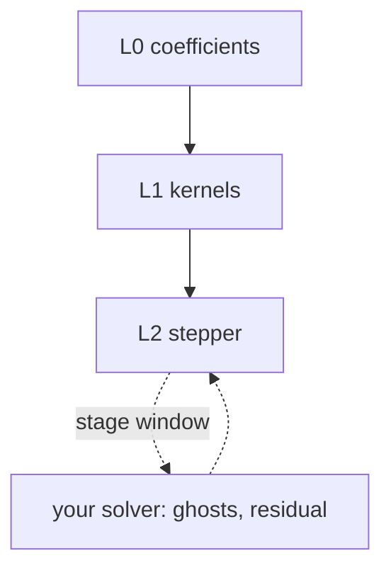

# About SELAH

SELAH (**S**tage-wise **E**volution **L**ibrary for **A**ccelerators and **H**PC) provides time-evolution operators
for block-structured field solvers on CPUs and GPUs: explicit Runge–Kutta schemes, their low-storage forms and
splitting schemes. The schemes come as coefficients, kernels and a stepper that a solver drives one stage at a time.
SELAH is the kernel-level successor of [FOODIE](https://github.com/szaghi/FOODIE), whose operator-overloaded
integrands are elegant but cost too much where the cells are swept.

*Selah* is the mark that appears 71 times in the Psalms and 3 times in Habakkuk, usually read as a pause: the music
stops and the singer breathes. SELAH's stage boundaries are such pauses. The solver acts there (ghost exchange, AMR seam
fill, reflux) before the integrator goes on.

## The three layers

- **L0, the coefficients** ([Schemes](./schemes)): eight Runge–Kutta schemes and four splittings, each in the form its
  source publishes, the other forms derived from it, every value verified.
- **L1, the kernels** ([Kernels](./kernels)): the stage operations over your arrays (a box of a block-structured field,
  or a flat array), one source for every backend.
- **L2, the stepper** ([Stepper](./stepper)): the registers and the sequence of kernels of one step, in five storage
  forms, called around your own ghost fill and residual.

You can use any layer alone: the coefficients for your own kernels, the kernels for your own step, or the stepper.

## Status

**v0.1.0** (2026-11-17). On `main`, not yet released:
- `stages_on_q` and `stage_state_is_q` ([Stepper](./stepper#stages-on-q));
- the 2N stage that no longer reads its register on the first stage;
- the validation of the caller's registers;
- this documentation.

## Design principles

1. No polymorphism, procedure pointers or callbacks in or around a kernel.
2. The caller owns the time loop and the residual evaluation; the library never calls back.
3. Kernels act on plain contiguous arrays with explicit lower bounds.
4. Box kernels update the interior only; the integrator never writes a ghost cell.
5. One working precision per build (PENF's `R_P`: R8P by default, R4P with `-D_R_P_IS_R4P`).
6. One kernel source for the host (OpenMP or not) and OpenACC, through FUNDAL's macros.
7. The summation order of every kernel is specified (a private sum, then one store), so golden tests can be bitwise.

## Where to go

- New to SELAH: the [Quick start](./quickstart), then the [Tutorial](/tutorial/).
- A specific task: the [Cookbook](/cookbook/).
- The evidence behind every claim: [Verification](/verification/).
- Every public entity: the [API reference](/api/).
