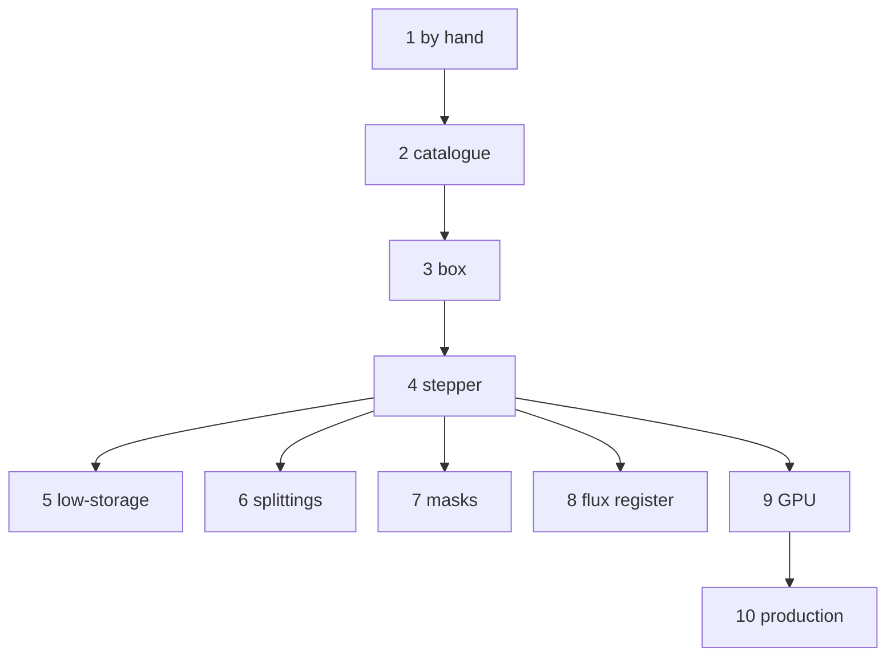

# Tutorial

Ten chapters that take a field solver from one Runge–Kutta step written by hand to a production loop on the GPU. Each
chapter is a complete program in `docs/examples/src/`. The code on these pages is that program, and the output is what
it printed when the documentation was built (`bash scripts/docs_examples.sh` regenerates both, and CI fails when they
drift).

The model problem is the linear advection $u_t + u_x = 0$ on the periodic unit interval, split into 4 blocks of 16
cells with one ghost cell each. The residual is the central difference
$R_i = -(u_{i+1} - u_{i-1})/(2\Delta x)$. Its semi-discrete solution is known exactly,
$u(x,t) = \sin(2\pi(x - ct))$ with $c = \sin(2\pi\Delta x)/(2\pi\Delta x)$, so every error printed below belongs to the
time integrator alone.

| Chapter | You learn |
|---|---|
| [1. A step by hand](./01-by-hand) | what a Runge–Kutta step is in SELAH's terms: the flat kernels `selah_stage_state` and `selah_step_update` |
| [2. The catalogue](./02-catalogue) | the schemes, their coefficients, storage forms and register counts; the splittings |
| [3. A field and a box](./03-box) | the block-structured field, ghost cells, the two layouts, what a kernel touches and what it leaves alone |
| [4. The stepper](./04-stepper) | driving one step stage by stage: what the stepper does, and what the caller does |
| [5. Low-storage forms](./05-low-storage) | the same scheme with 2 registers instead of s + 1, and the same answer |
| [6. Splittings](./06-splittings) | partitions, flows and `stage_partition` on a Hamiltonian oscillator |
| [7. Masks](./07-masks) | solid cells the integrator must not touch |
| [8. The flux register](./08-flux-register) | `stage_weight`: the conservation identity behind AMR refluxing |
| [9. On the GPU](./09-gpu) | the same solver on device memory, with FUNDAL |
| [10. Production](./10-production) | your own register pool, stage 1 without a copy, the fused step residual |



## Building the examples

Every program is compiled the way your own program would be: against the static library that FoBiS builds, which
carries PENF and FUNDAL.

```bash
fobis fetch                       # PENF, FUNDAL and GIDEON into src/third_party
fobis build --mode static-gnu     # lib/gnu/static/libselah.a and its modules
gfortran -cpp -DFUNDAL_NO_MPI -I lib/gnu/static/mod -I src/third_party/FUNDAL/src/lib \
         docs/examples/src/stepper.F90 lib/gnu/static/libselah.a -o stepper
./stepper
```

`bash scripts/docs_examples.sh` does this for every example, and rewrites the snippets and outputs these pages include.
